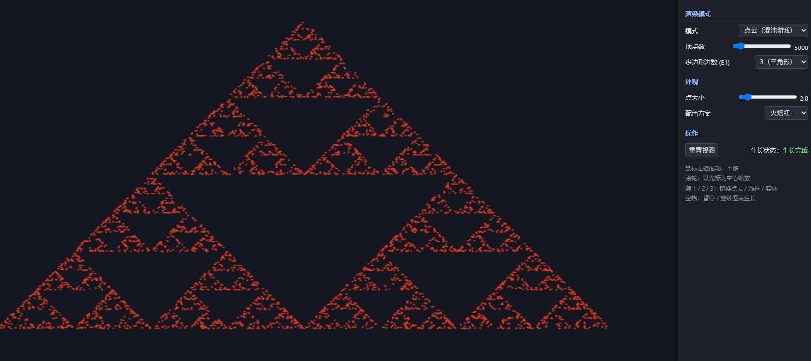
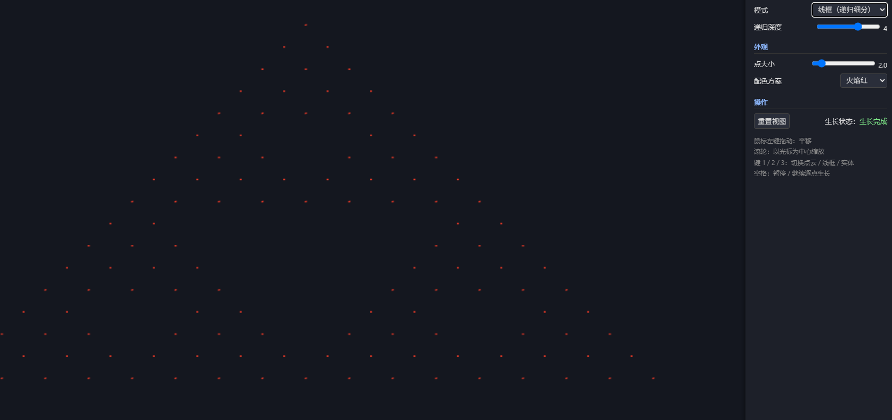
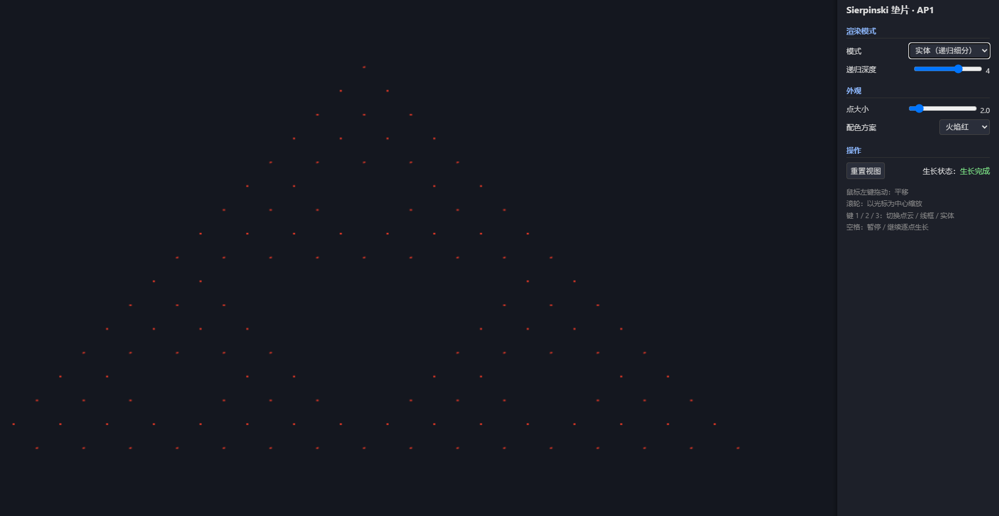
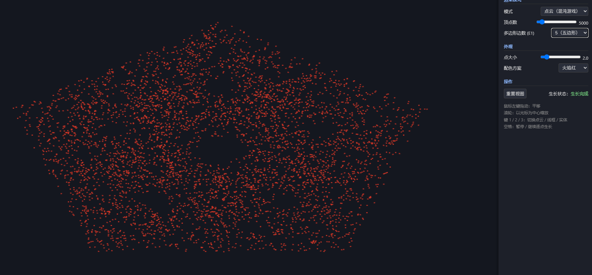

# AP1 · 交互式 2D 分形 — Sierpinski 垫片

**在线演示（公网 URL）**：https://c2-x.github.io/ap1-sierpinski/

课程项目（Angel & Shreiner, *Interactive Computer Graphics*, 8th ed., Ch2–3）。
原生 WebGL 2.0 + JavaScript，使用教材配套工具库风格（`Common/` 下 `initShaders.js` / `MV.js` / `webgl-utils.js`），无构建步骤。

## 运行方式

任意静态服务器从项目根目录启动即可，例如：

```bash
cd ap1
python -m http.server 8000
```

浏览器打开 `http://localhost:8000/`。直接双击 `index.html`（file://）在多数浏览器因安全限制无法加载，请使用静态服务器。

## 实现要点

### 两种生成算法

1. **混沌游戏（随机迭代）** —— `js/gasket.js: chaosGame()`
   反复执行 `p = (p + 随机顶点) / 2`，前 20 个点丢弃（避免初始点落在垫片外的杂点），其余以 `Float32Array` 组织、经 `gl.bufferData` 上传 VBO，用 `gl.POINTS` 渲染。
   该实现把多边形边数参数化，切换边数即可得到四边形 / 五边形 / 六边形混沌游戏垫片（选做 E1）。

2. **递归细分** —— `js/gasket.js: subdivide()`
   对三角形取三边中点，分成 4 个小三角形并丢弃中间一个，其余 3 个递归；深度为 0 时输出顶点。深度 0–6 均可运行（深度 6 共 729 个三角形）。
   同一批顶点数据支持三种渲染模式：点云 `gl.POINTS`、线框 `gl.LINES`（每三角形 6 个索引）、实体 `gl.TRIANGLES`。

### 数据流

`Float32Array` → `gl.bufferData` → VBO → `gl.vertexAttribPointer` → 顶点着色器 attribute。
平移 / 缩放通过 uniform（`u_offset` / `u_scale`）作用于顶点着色器，鼠标交互不重新上传几何数据。

### 逐点生长动画

点云模式下 `shownCount` 从 0 开始，每帧追加 300 个点（`gl.drawArrays(gl.POINTS, 0, shownCount)`），直到达到设定顶点数；空格键可暂停 / 继续。

## 交互说明

| 操作 | 效果 |
|---|---|
| 鼠标左键拖动 | 平移视图 |
| 滚轮 | 以光标位置为锚点缩放 |
| 键 `1` / `2` / `3` | 切换点云 / 线框 / 实体 |
| `空格` | 暂停 / 继续逐点生长动画 |
| 参数面板 | 顶点数（1000–50000）、递归深度（0–6）、点大小、3 套配色、多边形边数、重置视图 |

## 截图

**点云模式（混沌游戏，5000 点）**



**线框模式（递归细分，深度 4）**



**实体模式（递归细分，深度 4）**



**选做 E1：五边形混沌游戏**



## 文件结构

```
ap1/
├── index.html            # 页面、着色器源码（script 标签）、面板布局
├── Common/               # 教材配套工具库
│   ├── webgl-utils.js    # setupWebGL() / requestAnimFrame
│   ├── initShaders.js    # 从 script 标签编译链接着色器
│   └── MV.js             # vec/mat 工具（本项目实际使用 flatten/vec2 等）
├── js/
│   ├── gasket.js         # 几何算法（纯函数，不接触 GL）
│   ├── renderer.js       # WebGL 渲染（着色器、VBO、绘制、生长动画）
│   ├── interaction.js    # 鼠标 / 键盘事件
│   ├── ui.js             # 参数面板绑定
│   └── main.js           # 入口装配
├── screenshots/          # README 用截图
└── README.md
```

## 代码出处说明

`Common/` 下三个工具库为教材（Angel & Shreiner）配套公开代码的等价实现（本仓库内版本为按教材接口手写，接口与原版一致）；分形几何、渲染与交互代码均为独立撰写。

## 选做扩展

- **E1 任意 n 边形垫片**：已实现。混沌游戏顶点数参数化，面板可切 3/4/5/6/8 边形。观察结论：n=3 得到标准 Sierpinski 垫片；n≥4 时点集趋近均匀填满多边形内部，而不是形成自相似孔洞结构（见上方五边形截图）。
